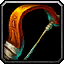

# Clean Ranged Sounds

A WoW Forever addon that mutes the creak of a bow being drawn before every shot, plus any other bow, crossbow or gun sound you pick. The creak is gone as soon as you log in, with nothing to set up.

## Features

- Mutes the bow pullback creak by default, on bows and crossbows alike.
- Lists the bow, crossbow and gun sounds, classic and modern, one tab per weapon. Untick a sound to mute it, click its speaker to hear it first.
- Untick the classic shots of a bow or gun to hear only its modern shots.
- Changes apply at once, with no reload.
- Your shots never go silent: they play one of the shot sounds you kept.
- Give any weapon another weapon's shots, such as crossbow snaps instead of the bow twang the game gives a crossbow, or crossbow shots on a gun for a silenced sound.

## Usage

1. Type `/crs`, pick Clean Ranged Sounds in the addon menu, or find it under Options > AddOns. It opens on the weapon you have equipped.
2. Click a speaker to hear a sound, and untick the ones to mute.
3. Under Your Gun Shots Play, or the same for your bow or crossbow, tick the shot sounds your weapon plays.
4. Click Defaults to reset the weapon you see.

Commands: `/crs`, `/crs intro` and `/crs help`.

A crossbow plays the bow's creak and twang, so you mute them on the Bow tab. A muted sound is muted for everyone, so other players' bows, crossbows and guns go quiet too. While your own shots play a pick of their own, other players' shots with that weapon are silent.
