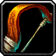

# Clean Ranged Sounds

Mute the bow creak before every shot, from the moment you log in, with nothing to set up.

- **Mutes** the bow draw creak by default
- **Lets you mute** any bow, crossbow or gun sound
- **Swaps** shot sounds between weapons

## Why use it

- **Zero setup.** The creak is gone at login.
- **Hear before you mute.** Every sound has a speaker to preview it.
- **Never silent.** Your shots always play one of the sounds you kept.
- **Silenced gun.** Give your gun crossbow shots.

## Features

- Bow, crossbow and gun sounds, classic and modern, one tab per weapon
- Untick a sound to mute it, click its speaker to hear it first
- Untick a weapon's classic shots to hear only its modern ones
- Give any weapon another weapon's shots, such as crossbow snaps instead of the bow twang the game gives a crossbow
- Changes apply at once, with no reload

## Quick start

1. Type `/crs`, or pick Clean Ranged Sounds in the addon menu or under Options > AddOns. It opens on your equipped weapon
2. Click a speaker to hear a sound, and untick the ones to mute
3. Under Your Gun Shots Play, or the same for your bow or crossbow, tick the shots your weapon plays
4. Click Defaults to reset the weapon you see

## Commands

`/crs`, `/crs intro` and `/crs help`

## Good to know

- A crossbow plays the bow's creak and twang, so you mute them on the Bow tab
- A muted sound is muted for everyone, so other players' bows, crossbows and guns go quiet too
- While your shots play a pick of their own, other players' shots with that weapon are silent
